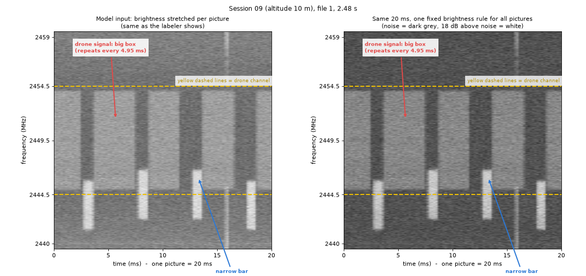

# RF 드론 탐지기

[](https://doi.org/10.5281/zenodo.23656790)

[English](README.md) | 한국어

**드론 신호는 공개 데이터로 합성해도 되지만, 간섭은 만들어 넣지 말고 배치할 장소의 실제 배경 IQ 데이터를 써야 혼잡한 환경에서 통합니다.**

HackRF One(순간 수신 대역폭이 20 MHz인 저가 SDR)으로 2.4 GHz 대역을 받습니다. IQ 데이터 20 ms마다 스펙트로그램 이미지 한 장(640 × 640)을 만듭니다. YOLO26s 검출 모델이 이 이미지에서 드론 영상 전송 신호에 경계 상자를 그립니다. 학습 이미지는 IQ 단계에서 합성하므로 사람이 라벨을 그린 이미지는 없습니다.

이 버전(v2.1)에는 지금 쓰고 있는 논문의 코드와 결과가 들어 있습니다. 논문 제목은 *Synthetic Drone Signals on Real Background IQ Data for Low-Cost SDR Drone Detection in Crowded Environments*입니다. 해커톤 버전(v1)은 [`v1/`](v1/README.ko.md) 폴더, `v1` 브랜치, `v1.0`과 `v1.1` 태그에 그대로 있습니다.



*이미지 한 장은 HackRF IQ 데이터 20 ms입니다(공원에서 고도 10 m로 나는 DJI Neo 2). 가로축은 시간 0–20 ms, 세로축은 주파수 20 MHz이고 위쪽이 높은 주파수입니다. 밝을수록 센 신호입니다. 왼쪽은 모델이 보는 이미지이고, 오른쪽은 같은 20 ms를 밝기 기준을 고정해 그린 것입니다. 노란 점선은 드론 채널을 표시하려고 덧그린 선이고, 그 사이에 반복되는 밝은 사각형이 드론 영상 전송 신호입니다.*

## 결과

학습에 쓰지 않은 두 혼잡 장소에서, 생성한 간섭으로 학습한 모델은 드론 전원을 끈 이미지를 거의 모두 드론으로 판정했습니다. 다른 혼잡 장소의 실제 배경으로 학습한 모델은 FPR이 2.5 %와 22.5 %였습니다.

**표 1. 혼잡 장소 실측 평가 결과 (%)**

| 모델 | 학습 배경 | 평가 장소 | 재현율, 드론 영상 전송 | FPR, 드론 전원 꺼짐 |
|---|---|---|---:|---:|
| 수원역 배경 모델 | 수원역 대합실, 드론 전원 꺼짐 | 전철 객차 | 93.7 | 2.5 |
| 객차 배경 모델 | 전철 객차, 드론 전원 꺼짐 | 수원역 대합실 | 86.8–88.9 | 22.5 |
| 생성 간섭 모델 40개 | 공원 배경 + 생성한 와이파이·블루투스, 간섭 밀도 네 조건 | 두 장소 | 99.8–100 | 98.1–100 |

- 재현율은 드론 영상을 전송한 이미지 가운데 Neo 2 채널에서 드론 경계 상자를 찾은 비율입니다.
- FPR(false positive rate)은 드론 전원을 끄고 취득한 이미지 가운데 드론 경계 상자를 하나라도 그린 비율입니다.
- 평가에 쓴 드론(DJI Neo 2)은 어느 모델의 학습에도 쓰지 않았습니다. 판정 임계값은 모델마다 자기 검증 데이터에서 정했습니다.
- 실제 배경 모델의 값은 시드 2개의 평균입니다. 생성 간섭 모델의 값은 학습 조건 4개의 범위이고, 조건마다 fold 5개 × 시드 2개의 평균입니다.

생성 간섭 모델이 모든 평가에서 약했던 것은 아닙니다. 스펙트럼 점유율 80 %로 합성한 평가 이미지에서 80 % 조건 모델의 FPR은 8.5 %였습니다. 실제 배경 모델은 배경 말고도 클래스 수(1개와 3개)와 학습에 쓴 기종 수(20개와 fold마다 약 16개)가 생성 간섭 모델과 다릅니다.

## 학습 이미지를 만드는 순서

1. **드론 신호.** 공개 데이터셋 4종(DRFF-R2, Tampere 대학 드론 RF 데이터, DroneDetect V2, RFUAV)에서 20개 기종의 드론 신호 세그먼트 303개를 잘라 냅니다.
2. **배경.** 두 가지 중 하나를 씁니다.
   - 생성 간섭: 공원에서 드론과 조종기 전원을 끄고 취득한 HackRF IQ 데이터(공원 배경) 20 ms에 생성한 와이파이·블루투스 버스트를 더합니다. 버스트 수는 스펙트럼 점유율 중앙값이 2, 20, 50, 80 %가 되도록 정했습니다. 이 모델들은 드론, 와이파이, 블루투스의 세 클래스를 찾습니다.
   - 실제 배경: 혼잡 장소 한 곳에서 드론 전원을 끄고 취득한 HackRF IQ 데이터 20 ms를 아무것도 더하지 않고 씁니다. 이 모델들은 드론 한 클래스만 찾습니다. 수원역 배경은 약 10초, 객차 배경은 약 117초 분량입니다.
3. **합성.** 드론 신호 세그먼트를 SNR 6–25 dB로 배경에 IQ 단계에서 더하고 스펙트로그램으로 바꿉니다. 정답 경계 상자는 신호를 넣은 위치에서 바로 나옵니다.
4. **학습.** COCO 가중치에서 시작한 YOLO26s를 40 에포크, 배치 크기 16으로 학습하고 마지막 에포크 가중치를 씁니다. 모델마다 학습 데이터 6,000장, 검증 데이터 600장입니다. 판정 임계값은 검증 데이터에서 이미지 단위 F1 점수가 가장 높은 값입니다.

생성 간섭 모델은 학습 조건 4개 × fold 5개 × 시드 2개로 40개입니다. fold마다 제품 계열 하나(Mini, Air, Mavic, 전문가용, 타 제조사)를 학습에서 빼고, 뺀 계열로 미학습 계열 평가를 합니다. 실제 배경 모델은 장소와 시드마다 하나씩, 모두 4개입니다. 학습 전에는 데이터 누출(data leakage) 점검을 돌립니다(`paper/results/leak_check.md`, `paper/results/exp2/leak.txt`). 논문에 쓴 HackRF 데이터는 모두 수신 필터 20 MHz로 취득했습니다.

## 논문의 이름과 코드의 이름

파일 이름과 코드 안의 이름은 실험을 돌릴 때의 이름을 그대로 씁니다. 결과 표(`paper/results/*.md`) 안의 글자는 논문의 이름을 씁니다.

**표 2. 논문의 이름과 코드의 이름**

| 논문의 이름 | 코드와 파일의 이름 |
|---|---|
| 생성 간섭 모델 | `<fold>_<학습 조건>_s<시드>`, 예: `f1_mini_c80_s1` |
| 2 %, 20 %, 50 %, 80 % 조건 | `c02`, `c20`, `c50`, `c80` |
| Mini, Air, Mavic, 전문가용, 타 제조사를 뺀 fold | `f1_mini`, `f2_air`, `f3_mavic`, `f4_pro`, `f5_other` |
| 객차 배경 모델 | `test2_1_s1`, `test2_1_s2` |
| 수원역 배경 모델 | `test2_2_s1`, `test2_2_s2` |
| 미학습 계열 평가(합성) | `test1_1` (`rev1_eval.py`) |
| Neo 2 합성 평가 | `test1_2` (`rev1_test1_2.py`) |
| 저간섭 실측 평가(공원, 실내) | `test1_3`, `baseline` (`rev1_eval.py`) |
| 혼잡 장소 실측 평가 | `test1_4` (`rev1_test1_4.py`) |

파일 이름의 `rev1`은 논문의 실험 설계를 가리키며 저장소의 v1과 관계없습니다. 결과 표와 코드 주석은 한국어로 썼습니다.

## 폴더 구성

```
paper/src/              논문 실험 코드
  rev1_common.py          fold, 간섭 밀도 조건, 시드, 이미지 수, 폴더 위치
  rev1_synth.py           생성 간섭 이미지: 간섭 밀도 맞추기, 학습·검증·평가 데이터
  rev1_test1_2.py         Neo 2 합성 평가: 이미지 만들기와 평가
  rev1_leak.py            데이터 누출 점검(모든 항목을 통과해야 학습 시작)
  rev1_eval.py            판정 임계값, 미학습 계열 평가, 저간섭 실측 평가
  rev1_report.py          생성 간섭 모델 40개의 결과 표
  rev1_test1_4.py         혼잡 장소 실측 평가
  rev1_exp2.py            실제 배경 모델: 이미지, 누출 점검, 평가, 결과 표
  rev1_gt_vis.py          정답 경계 상자를 그린 확인용 이미지
  occupancy.py            스펙트럼 점유율 계산
  noise_level.py          배경의 잡음 세기 계산
  neo2_burst_sessions.py  Neo 2 버스트 길이와 반복 간격 측정
  fig_rev1.py, fig_rev2.py, fig_exp2_curves.py   논문 그림(한국어)
paper/results/          결과 표와 누출 점검 결과
src/                    공통 모듈: IQ 합성, 스펙트로그램, 드론 신호 세그먼트, 배경 잡음, 학습
scripts/                reproduce_paper.sh, download_drff_r2.sh
data/labels/, data/lists/   사람이 확인한 DRFF-R2 드론 대역, DRFF-R2 파일 목록
v1/                     해커톤 버전(v1.1)
```

## 재현 방법

1. **환경.** v1과 같습니다. 장비는 NVIDIA DGX Spark(GB10)이고, conda 환경의 Python 3.11.16에 CUDA 13.0용 torch 2.14.0과 ultralytics 8.4.157을 썼습니다. `requirements-lock.txt`는 논문 실험을 돌린 환경의 전체 패키지 목록입니다.

   ```bash
   conda create -n rfdd python=3.11.16 -y && conda activate rfdd
   pip install torch==2.14.0 torchvision==0.29.0 --index-url https://download.pytorch.org/whl/cu130   # 다른 GPU는 자기 CUDA에 맞는 torch 2.14.0
   pip install -r requirements.txt
   ```

   [v1.0 릴리스](https://github.com/sinkei9456/rf-drone-detector/releases/tag/v1.0)의 COCO 사전학습 가중치 `yolo26s.pt`를 `src/`에 넣습니다.
2. **데이터.** v1 README의 [데이터](v1/README.ko.md) 절과 같은 구성으로 `data/raw/`에 넣습니다. 공개 데이터셋 4종은 약 150 GB이고, v1.0 릴리스의 해커톤 HackRF 데이터는 5.6 GB입니다. 혼잡 장소 데이터의 위치는 `data/raw/hackrf/4_neo2_crowded_20261114/`이지만 공개하지 않습니다(아래 데이터 절).
3. **실행.** 저장소 맨 위 폴더에서 돌립니다.

   ```bash
   bash scripts/reproduce_paper.sh                       # materials, generated, crowded
   bash scripts/reproduce_paper.sh materials generated   # 공개 데이터만으로 돌아가는 부분
   ```

   **표 3. 재현 단계와 걸리는 시간 (DGX Spark 한 대)**

   | 단계 이름 | 하는 일 | 걸리는 시간 |
   |---|---|---|
   | `materials` | 공원 배경과 드론 신호 세그먼트 만들기(v1의 02–07 단계) | — |
   | `generated` | 이미지 합성, 누출 점검, 학습과 평가 40회, 결과 표 | 약 38시간(추정) |
   | `crowded` | 생성 간섭 모델 40개의 혼잡 장소 실측 평가, 실제 배경 모델 4개의 학습과 평가 | 약 5시간(추정) |
   | `figures` | 논문 그림(나눔고딕 글꼴 필요) | — |

   단계마다 `runs/logs/paper_<단계>.log`에 기록이 남고, 다시 돌리면 끝난 단계는 건너뜁니다. 결과는 `paper/runs/rev1/`에 쌓입니다. 논문에 쓴 결과는 `paper/results/`에 복사해 두었습니다.

v2.1을 새로 받은 사본에서 모델 44개의 평가를 모두 다시 돌렸고, 이미지마다의 출력이 `paper/results/`와 같았습니다([재현 확인](#재현-확인)). 이미지 합성과 학습은 새 사본에서 다시 돌리지 않았습니다.

## 공개 가중치

[v2.1 릴리스](https://github.com/sinkei9456/rf-drone-detector/releases/tag/v2.1)에 표 1의 실제 배경 모델 4개를 올렸습니다. 생성 간섭 모델 40개는 올리지 않았고, `scripts/reproduce_paper.sh generated`로 다시 학습할 수 있습니다.

**표 4. 가중치 파일 (판정 임계값은 모델마다 자기 검증 데이터에서 정한 값)**

| 파일 | 모델 | 학습 배경 | 판정 임계값 |
|---|---|---|---:|
| `test2_1_s1.pt` | 객차 배경 모델, 시드 1 | 전철 객차, 드론 전원 꺼짐 | 0.02 |
| `test2_1_s2.pt` | 객차 배경 모델, 시드 2 | 전철 객차, 드론 전원 꺼짐 | 0.01 |
| `test2_2_s1.pt` | 수원역 배경 모델, 시드 1 | 수원역 대합실, 드론·조종기 전원 꺼짐 | 0.06 |
| `test2_2_s2.pt` | 수원역 배경 모델, 시드 2 | 수원역 대합실, 드론·조종기 전원 꺼짐 | 0.04 |

체크섬은 릴리스의 `SHA256SUMS_weights.txt`에 있습니다. 파일마다 클래스가 하나(`drone`)인 Ultralytics YOLO26s 모델입니다. 입력은 `src/iq_to_image.py`가 HackRF IQ 데이터(2.4 GHz, 20 MS/s)로 만든 이미지입니다. 드론 경계 상자의 신뢰도가 판정 임계값 이상이면 그 이미지를 드론 존재로 판정합니다.

```python
from ultralytics import YOLO
model = YOLO("test2_2_s1.pt")
boxes = model.predict("image.png", conf=0.06, verbose=False)[0].boxes
```

파일 안에 저장된 학습 경로는 상대 경로와 위 이름으로 바꿨습니다. 가중치 값은 바꾸지 않았습니다. v2.0 릴리스에는 지금 논문에서 뺀 비교 모델의 가중치 2개(`test2_c_s1.pt`, `test2_c_s2.pt`)도 남아 있습니다.

## 재현 확인

논문의 모델 44개(생성 간섭 모델 40개, 실제 배경 모델 4개)를 v2.1을 새로 받은 사본에서 다시 평가했습니다. 장비와 환경은 논문 실험과 같습니다. 사본에는 기존의 합성 이미지, HackRF 데이터, 모델 가중치를 링크로만 연결했습니다. 그 뒤의 단계는 모두 사본에서 돌렸습니다. 누출 점검, 평가 데이터 점검, 혼잡 장소 IQ 파일 목록, 모든 평가, 결과 표, 그림 2와 그림 6입니다.

**표 5. 새 사본에서 다시 돌린 평가 (모델 하나당 이미지 수)**

| 평가 | 이미지 수 (장) | 모델 수 (개) |
|---|---:|---:|
| 검증 데이터 | 600 | 44 |
| 미학습 계열 평가 | 4,000 | 40 |
| Neo 2 합성 평가 | 2,000 | 40 |
| 저간섭 실측 평가 | 6,366 | 44 |
| 혼잡 장소 실측 평가 | 15,163 | 44 |

모든 모델과 평가에서 이미지마다의 출력이 논문의 값과 같았습니다. 비교한 출력은 이미지의 가장 높은 드론 신뢰도와 드론 위치에 맞은 경계 상자의 가장 높은 신뢰도입니다. 검증 데이터로 정한 판정 임계값도 같았습니다. 비교 항목은 256개이고 다른 항목은 0개입니다.

저간섭 실측 평가는 이제 6,366장입니다. 수신 필터 15 MHz로 취득한 실내 드론 부재 데이터 250장을 뺐고, 나머지 이미지는 한 장씩 비교했습니다. 누출 점검은 모두 통과했습니다. 혼잡 장소 IQ 파일 목록, 혼잡 장소 이미지마다의 스펙트럼 점유율, Neo 2 버스트 위치도 같았습니다. DGX Spark 한 대에서 2시간 37분 걸렸습니다.

### 원본 데이터부터 다시 실행 (2026-11-25)

main을 새로 받은 사본에서 `scripts/reproduce_paper.sh`로 원본 IQ 데이터부터 다시 실행했습니다. 장비와 환경은 논문 실험과 같습니다. 사본에는 `data/raw/`와 COCO 가중치 `src/yolo26s.pt`만 연결했고, 세그먼트, 이미지, 레이블, 모델은 모두 사본에서 새로 만들었습니다.

- 데이터셋은 논문과 같았습니다. 생성 간섭 모델 40개와 실제 배경 모델 4개의 학습·검증 이미지 목록(모델마다 학습 6,000장, 검증 600장), 합성 요약, 누출 점검, Neo 2 합성 평가, 혼잡 장소 이미지(수원역 2,516장, 객차 12,647장), 혼잡 장소 IQ 파일 목록, 잡음 세기가 모두 같았습니다. 표본으로 비교한 이미지는 바이트까지 같았습니다.
- 생성 간섭 모델 40개 중 9개(`f1_mini_*_s1`, `f2_air_*_s1`, `f3_mavic_c02_s1`)를 COCO 가중치부터 다시 학습했습니다. 검증 데이터로 정한 판정 임계값과 이미지마다의 출력이 논문과 같았습니다. 가중치 파일 자체는 바이트가 달랐습니다. 나머지 모델은 다시 학습하지 않았습니다.
- 처음 실행은 05단계에서 멈췄습니다. 공원 세션 폴더를 고르는 패턴이 IQ 파일이 없는 문서 폴더까지 골랐기 때문입니다. 지금은 세션 01–13만 고릅니다.

### 수치가 달라질 수 있는 이유

데이터셋은 고정한 시드로 CPU에서 만들므로 GPU와 관계가 없습니다. 학습과 추론은 GPU에서 돌립니다. GPU, 드라이버, CUDA, PyTorch, Ultralytics 버전이 다르면 부동소수점 연산 순서가 바뀔 수 있어서, 같은 시드여도 가중치, 신뢰도, 판정 임계값이 조금 다를 수 있습니다. 논문 실험 장비(DGX Spark 한 대, `requirements-lock.txt`)에서는 다시 실행한 출력이 같았습니다. 추론 시간은 장비와 동시에 돌던 다른 작업에 따라 달라집니다.

## v2.1 이후 바뀐 점

- `scripts/reproduce_paper.sh`: 05단계는 공원 세션 01–13만 고릅니다.
- `paper/results/RESULTS.md`, `paper/src/rev1_report.py`: 저간섭 실측 데이터의 스펙트럼 점유율을 "대부분 0.1–0.9 %, 공원 세션 01·13과 실내 Neo 2 전원 켜짐 데이터는 2.4–4.1 %"로 고쳤습니다. 표 3-2는 세션을 고도가 아니라 드론까지의 거리(약 50 m)로 부릅니다.
- `paper/src/noise_level.py`, `paper/results/exp2/noise_level.json`: 공원, 객차, 수원역 배경의 잡음 세기(4.3절). `rev1_exp2.py`의 주석도 이 값으로 바꿨습니다.

## v2.0에서 바뀐 점

- 혼합 조건(네 간섭 밀도 조건의 이미지를 1:1:1:1로 섞은 학습 조건)을 뺐습니다. 생성 간섭 모델은 40개입니다. 그림 6과 실제 배경 모델의 비교 표는 80 % 조건과 비교합니다.
- 실제 배경 모델과 배경만 다르게 학습한 비교 모델(`test2_c`)을 뺐습니다.
- 수신 필터 20 MHz로 취득한 HackRF 데이터만 씁니다. 수신 필터 15 MHz로 취득한 실내 드론 부재 데이터(10-07)는 더 이상 평가하지 않고, 안테나를 분리하고 취득한 수신기 잡음(15 MHz)도 준비하거나 그리지 않습니다.
- 결과 표의 글자를 논문의 이름으로 바꿨습니다(숫자, 파일 이름, JSON 키는 그대로).

## 데이터

- 공개 데이터셋: DRFF-R2, Tampere 대학 드론 RF 데이터, DroneDetect V2, RFUAV입니다. 라이선스는 각 데이터셋을 따릅니다. 받는 방법과 폴더 구성은 v1 README에 있습니다.
- 해커톤 HackRF 데이터(공원과 실내, DJI Neo 2 전원 켜짐과 꺼짐): [v1.0 릴리스](https://github.com/sinkei9456/rf-drone-detector/releases/tag/v1.0)의 `hackrf_*.tar` 파일이며 CC BY 4.0입니다. 논문에는 이 가운데 수신 필터 20 MHz로 취득한 공원과 실내(10-08) 데이터만 씁니다.
- 혼잡 장소 HackRF 데이터(수원역 대합실, 수도권 전철 1호선 객차, 2026-11-14 취득): 원본 IQ 데이터에 다른 사람들의 송신 신호가 들어 있어 공개하지 않습니다. 결과는 `paper/results/test1_4/`와 `paper/results/exp2/`에 있습니다.

## 인용

이 저장소(모든 버전): Kim, Jeonghwan. RF Drone Detector. Zenodo. https://doi.org/10.5281/zenodo.23656790. 논문 실험 코드인 v2.1 버전의 DOI는 https://doi.org/10.5281/zenodo.24471317이고, v2.0 버전의 DOI는 https://doi.org/10.5281/zenodo.24345339입니다. `CITATION.cff` 파일도 들어 있습니다. 논문은 작성 중입니다.

## 라이선스

코드와 모델 가중치는 AGPL-3.0(`LICENSE`)입니다. 코드가 Ultralytics YOLO(AGPL-3.0)를 쓰고 모델이 Ultralytics 가중치에서 시작했기 때문입니다.
v1.0 릴리스의 해커톤 HackRF 데이터(`hackrf_*.tar`)는 CC BY 4.0입니다(https://creativecommons.org/licenses/by/4.0/). 쓸 때 이 저장소를 인용해 주십시오.
공개 데이터셋은 각자의 라이선스를 따르며 이 저장소에서 다시 배포하지 않습니다.
