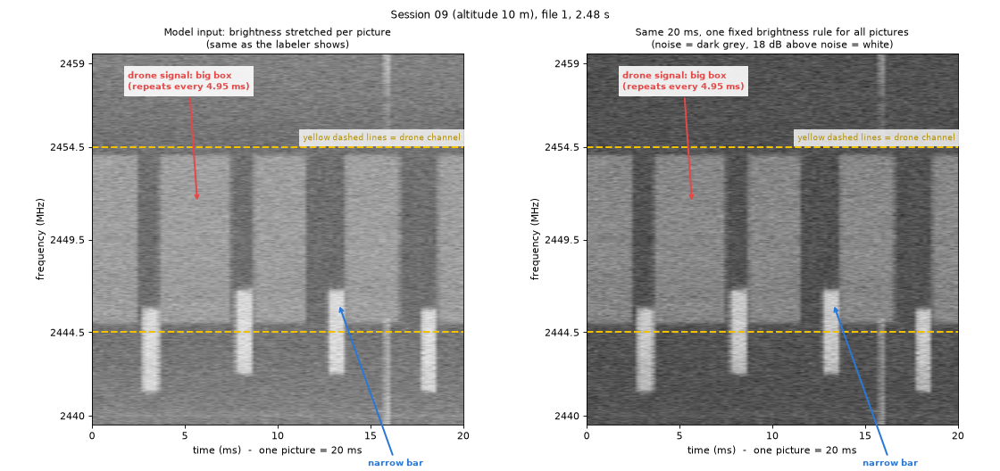
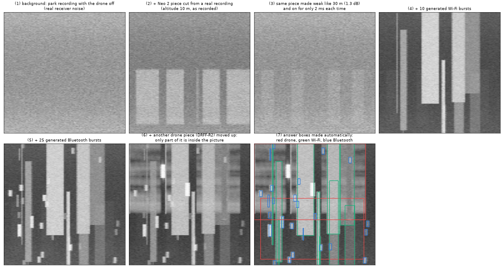
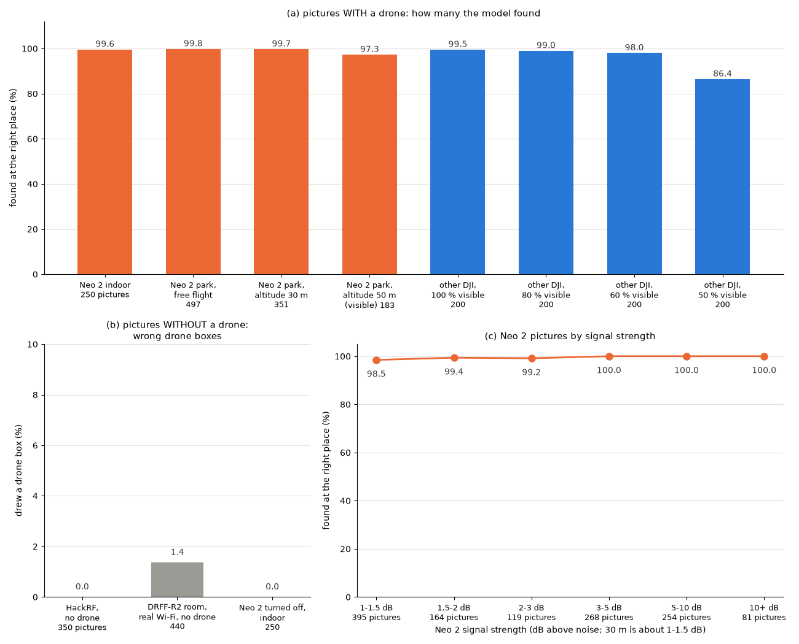

# RF 드론 탐지기

[](https://doi.org/10.5281/zenodo.23656790)

[English](README.md) | 한국어

**수동형 RF 드론 탐지: HackRF One 의 20 ms 스펙트로그램에서 드론 영상 신호를 찾는 YOLO 검출 모델, IQ 단계 합성 그림 위주로 학습**

D4D x EDTH 해커톤 2026, 과제 T1-3 "수도권 영공 소형드론·풍선 침투 대응 (Gray-zone C-UAS)". 작은 소프트웨어 정의 수신기(HackRF One)가 2.4 GHz 대역을 한 번에 20 MHz 폭으로 듣는다. IQ 20 ms 마다 640 × 640 스펙트로그램 그림 한 장을 만들고, YOLO26s 검출 모델이 드론 영상 신호·와이파이·블루투스에 박스를 그린다. 드론 박스는 곧 드론 신호의 시각(ms)과 주파수(MHz)다. 듣기만 하므로 주변 통신을 방해하지 않는다.

이 저장소에는 공개한 모델 `model_02a.pt` 를 만든 코드(원본 녹음 → 학습한 모델 → 테스트 결과)와 CPU 배포 코드가 들어 있다.



*그림 한 장 = HackRF 녹음 20 ms(공원에서 고도 10 m 로 날고 있는 DJI Neo 2). 가로는 시간 0–20 ms, 세로는 주파수 20 MHz(위가 높은 주파수), 밝을수록 센 전파다. 왼쪽은 모델이 보는 그림(그림마다 밝기를 늘림), 오른쪽은 같은 20 ms 를 고정된 밝기 기준으로 그린 것이다. 노란 점선(우리가 그려 넣은 선) 사이가 드론 채널이고, 그 사이에 되풀이되는 밝은 사각형이 드론 영상 신호다.*

## 방법

**왜 스펙트로그램인가.** 원래 IQ(20 ms 에 복소수 40만 개)로는 사람 눈에도 그림 모델에도 신호가 보이지 않는다. 시간 × 주파수 × 세기의 그림으로 펼치면 신호마다 모양이 다르다. 드론 영상 신호는 폭 10–20 MHz 의 사각형이 일정한 간격으로 되풀이되고, 와이파이는 폭 20 MHz 의 짧은 막대, 블루투스는 폭 1–2 MHz 의 작은 조각이다. 그래서 이미 잘 검증된 물체 검출 모델로 신호마다 시간·주파수 범위를 찾을 수 있고, 신호가 겹쳐도 따로 찾는다. 받는 속도가 다른 녹음(HackRF 초당 2천만 개, 공개 데이터 초당 1억 개)도 같은 20 MHz × 20 ms 격자로 다시 만든다. 대신 위상(기체마다 다른 전파 버릇, RF 지문)과 세기의 절댓값(그림마다 밝기를 맞춤, 아주 약한 신호는 잡음 무늬와 비슷해짐)은 잃는다.

**IQ 단계 합성.** 실제 드론을 여러 높이·장소에서 날려 녹음하고 박스를 일일이 사람이 그리는 일은 오래 걸리고 틀리기 쉽다. 그래서 실제 녹음에서 드론 신호 조각을 잘라 실제 HackRF 바탕 잡음 위에 IQ 단계에서 더한 뒤 그림을 한 번만 만든다. 신호가 겹친 모양과 잡음이 실제 수신기와 같고, 정답 박스는 조각을 넣은 위치에서 저절로 나온다.



*합성 그림 한 장을 만드는 순서: (1) 바탕, 공원에서 드론·조종기를 끄고 받은 실제 HackRF 잡음 (2) 공원 고도 10 m 녹음에서 잘라 낸 DJI Neo 2 조각 (3) 같은 조각을 고도 30 m 수준(잡음보다 1.3 dB 셈)으로 약하게 하고 한 번 켜져 있는 시간을 2 ms 로 줄임 (4) 만든 와이파이 10개 (5) 만든 블루투스 25개 (6) 다른 드론(공개 데이터 DRFF-R2 의 DJI 드론) 조각을 위로 옮겨 일부만 그림 안에 들어오게 함 (7) 자동으로 만든 정답 박스(빨강 드론, 초록 와이파이, 파랑 블루투스).*

학습 그림에 일부러 넣은 상황:

- 전파 포화: 그림 한 장에 와이파이 최대 12개, 블루투스 최대 30개
- 높이·멀리 떠서 약해진 신호: 고도 10 m 녹음의 Neo 2 조각을 30 m 수준(공원에서 잰 값, 잡음보다 1–2 dB)으로 약하게 하고, 날고 있는 조각의 절반은 한 번 켜져 있는 시간을 1.5–3.5 ms 로 줄임. 하한은 1 dB 이다. 이보다 약하면 그림에 없는 신호에 박스를 주게 된다.
- 수신기 20 MHz 창에 잘린 드론 신호: 신호 폭의 50 % 이상 보이는 경우까지
- 실제 "드론 아님" 그림(실제 와이파이가 있는 방, 수신기 잡음)을 "찾을 것 없음"으로 학습

**검출 모델.** Ultralytics YOLO26s. COCO 객체 검출로 사전학습된 가중치(`yolo26s.pt`)에서 시작해 스펙트로그램 그림으로 모든 층을 다시 학습했다(전체 파인튜닝, 전이학습). 가중치 묶음 708개 중 696개를 가져왔고, 찾는 종류 수에 묶인 출력 부분만 새로 만들었다. 40회차, 배치 16, 시드 0, 그림 크기 640, 마지막 회차 가중치. 처음부터 학습한 모델과는 비교하지 않아, COCO 사전학습의 효과는 재지 않았다.

| 모델 2a 학습 데이터 (그림 장수) | 학습 | 검증 |
|---|---:|---:|
| 합성 그림 (합성 v10) | 6,000 | 600 |
| 실제 "드론 아님" 그림 | 1,720 | 230 |
| 합계 | 7,720 | 830 |

- 드론 조각: 공개 데이터(DRFF-R2, Tampere, DroneDetect, RFUAV)에서 303개(학습 158, 검증 51, 테스트 전용 94), 우리 공원 녹음의 DJI Neo 2 조각 1,643개(학습 1,205, 검증 438)
- 바탕: 반은 실내 HackRF 잡음(안테나 뺌, 블루투스 덩어리 지움), 반은 드론을 끈 공원 녹음
- 합성 학습 그림: 드론 있음 3,558장(그중 드론 2개 552장), 와이파이·블루투스만 1,512장, 바탕만 930장

## 결과

테스트 그림은 모두 학습·검증에 쓰지 않은 녹음에서 나왔다. 모델이 신뢰도 0.25 이상인 드론 박스를 정답 박스와 충분히 겹치게(IoU 0.3 이상) 그렸을 때만 "찾음"으로 센다. 공개한 모델 `model_02a.pt` 의 결과:

| 테스트 | 찾은 그림 / 그림 수 (장) | 비율 |
|---|---:|---:|
| HackRF, 실내 땅 위 DJI Neo 2 (2–3 m) | 249 / 250 | 99.6 % |
| HackRF, 공원 자유비행 Neo 2 | 496 / 497 | 99.8 % |
| HackRF, 공원 고도 30 m Neo 2 (그림에 신호가 보이는 것) | 350 / 351 | 99.7 % |
| HackRF, 공원 고도 약 50 m Neo 2 (그림에 신호가 보이는 것) | 178 / 183 | 97.3 % |
| DRFF-R2, 최신 DJI 8기종(다른 수신기), 드론 신호가 100 / 80 / 60 / 50 % 보일 때 | | 99.5 / 99.0 / 98.0 / 86.4 % |
| 합성 테스트, 드론 있는 그림 (학습과 같은 합성, 테스트 전용 조각) | 508 / 519 | 97.9 % |

| 오경보 테스트 (드론 없는 그림) | 드론 박스를 그린 그림 / 그림 수 (장) |
|---|---:|
| HackRF 수신기 잡음 (안테나 뺌·끼움) | 0 / 350 |
| DRFF-R2, 실제 와이파이가 있는 방 | 6 / 440 |
| HackRF 실내, Neo 2 를 끈 그림 | 0 / 250 |
| 합계 | 6 / 1,040 (0.6 %) |



*(a) 드론이 있는 그림에서 위치까지 맞혀 찾은 비율(%). 주황 = HackRF Neo 2 테스트, 파랑 = DRFF-R2 DJI 드론(보이는 비율별), 막대 아래 숫자는 그림 수. (b) 드론이 없는 그림에 드론 박스를 그린 비율(%). (c) Neo 2 그림을 잡음 대비 신호 세기별로 나눈 결과.*

이 숫자의 한계:

- 공원 테스트는 Neo 2 학습 조각과 같은 날·같은 장소의 녹음이다. 다른 장소·시간인 실내 테스트가 가장 공정하다.
- 고도 30 m 숫자는 덜 믿어야 한다. 켜져 있는 시간 줄이기를 그 30 m 테스트 녹음의 모양을 보고 넣었다.
- 약 50 m 에서 Neo 2 신호는 잡음보다 0.4 dB 세다. 신호가 그림에서 안 보이는 공원 그림 2,989장은 맞고 틀림을 셀 수 없다.
- 2.4 GHz 만 본다. 전파를 내지 않는 드론이나 무선 장비가 없는 풍선은 찾을 수 없다.
- 모델 2a 의 와이파이·블루투스 박스는 믿기 어렵다(실제 와이파이도 "찾을 것 없음"으로 배움). 드론 박스만 쓴다.

## 재현 확인

2026-10-11 에 이 저장소의 새 복사본에서 `scripts/reproduce.sh` 로 전체 과정을 다시 돌렸다(NVIDIA DGX Spark(GB10), 새로 만든 환경이 아니라 원래 분석에 쓴 가상환경 그대로이며 그 전체 패키지 목록이 `requirements-lock.txt`). HackRF 녹음은 릴리스 파일에서 풀었고, 공개 데이터는 "데이터"에 적은 부분만 썼다. 중간 파일을 모두 공개한 모델을 만들 때의 파일과 바이트 단위로 비교했다.

| 단계 | 결과 |
|---|---|
| HackRF 바탕, 드론 조각(공개 데이터 303개, Neo 2 1,643개), Neo 2 그림과 자동 레이블 | 같음 |
| 합성 그림 v8 (7,600장)과 테스트 2 그림 (1,840장), 정답 포함 | 같음 |
| 실제 "드론 아님" 그림 (1,950장)과 학습용 합성 그림 v10 (6,600장), 정답 포함 | 같음 |
| 모델 2a 학습: 40회차 모두의 손실·검증 값 | 같음 |
| 학습한 가중치 (708개) | 같음(가장 큰 차이 0.0). `.pt` 파일은 날짜·폴더 같은 기록만 다름 |
| 재현한 모델과 공개한 모델의 테스트 1–4 | "결과"의 숫자와 같음(테스트 4 는 그림 한 장 한 장까지) |

- 시간: 약 1.5시간(그중 학습 54분). 디스크: 원본 데이터 155 GB, 과정에서 만드는 파일 13 GB.
- 다시 계산하지 않는 입력이 하나 있다: DRFF-R2 자동 대역 후보. 지금의 `drff_prep.py scan` 은 사람이 대역을 확인할 때와 비교해 73개 중 14개 파일에서 후보가 조금 다르게 나온다. 그래서 `scripts/reproduce.sh` 는 확인을 거친 후보(`data/labels/drff_scan_reviewed/`)를 쓴다(훑기로 계산한 파일별 신호 배열은 같았다).
- 숫자가 똑같이 나오려면 같은 소프트웨어 판과 같은 종류의 GPU 가 필요하다. 다른 장비에서는 아주 작은 차이가 날 수 있다.
- 학습을 시작할 때 Ultralytics 가 혼합 정밀도 확인용 `yolo26n.pt` 를 내려받으므로, 학습 장비는 인터넷에 연결되어 있어야 한다.

## 저장소 구성

```
rf-drone-detector/
├── data/
│   ├── labels/                      사람이 확인한 DRFF-R2 드론 대역(정답의 일부)
│   │   ├── drff_band_fix.json       사람이 고친 대역
│   │   └── drff_scan_reviewed/      확인을 거친 자동 대역 후보(73개)
│   └── lists/drff_r2_files.txt      쓴 DRFF-R2 파일 목록(fileId, 크기, 경로)
├── deploy/                          CPU 배포(라즈베리 파이 64비트 OS 또는 일반 리눅스 PC)
│   ├── models/model_02a.pt          공개한 모델
│   ├── samples/                     설치 확인용 그림 40장
│   ├── samples_expected/model_02a/  samples/ 를 우리 서버에서 model_02a.pt 로 돌린 결과
│   ├── src/iq_to_image.py           녹음(.cs8 또는 SigMF) → 20 ms 그림
│   ├── src/predict.py               그림 → 드론 박스, CSV, 요약
│   └── environment.yml              conda 환경(CPU 용 torch)
├── docs/figures/                    이 README 의 그림
├── scripts/
│   ├── download_drff_r2.sh          DRFF-R2 파일 73개 받기
│   ├── make_hackrf_bundles.py       HackRF 릴리스 묶음을 만든 방법
│   └── reproduce.sh                 원본 녹음 → model_02a → 테스트 1–4
├── src/                             파이프라인 코드(주석은 한국어)
├── LICENSE                          AGPL-3.0
├── README.md / README.ko.md
├── requirements.txt                 학습 환경(requirements-lock.txt = 전체 pip freeze)
└── requirements-lock.txt
```

`src/` 는 실제로 돌린 연구 코드를 그대로 둔 것이라, 몇몇 파일에는 이전 판도 함께 들어 있다(예: `synth_iq_build.py --ver v2 … v11`). 모델 2a 는 조각 `v3` → `v7`, 테스트용 합성 `v8`, 학습용 합성 `v10` 을 쓴다.

## 공개한 모델 쓰기 (CPU)

```bash
cd deploy
conda env create -f environment.yml          # Python 3.11, CPU torch 2.14.0, ultralytics 8.4.157
conda activate d4d_detector
# 설치 확인: 드론 있음/없음 칸이 우리 서버 결과와 같아야 한다
python src/predict.py --images samples --model models/model_02a.pt --out output/check --device cpu
diff <(cut -d, -f1,8 output/check/pictures.csv) <(cut -d, -f1,8 samples_expected/model_02a/pictures.csv) && echo "서버와 같음"
# 직접 받은 HackRF 녹음(.cs8 와 그 .json, 또는 SigMF 폴더), 2.4 GHz, 20 MS/s
python src/iq_to_image.py --input <녹음 파일 또는 폴더> --out work/images
python src/predict.py --images work/images --model models/model_02a.pt --device cpu
```

라즈베리 파이는 64비트 OS 를 써야 한다(32비트 ARM 용 torch 가 없음). 우리 ARM 서버 CPU 에서 그림 한 장을 만드는 데 약 60–75 ms, 모델에 약 0.35–0.4 초가 걸렸다.

## 모델 재현하기

1. **환경.** 분석(학습·합성·평가)에 쓴 환경은 다음과 같다.

   | 항목 | 버전 |
   |---|---|
   | OS, CPU | Ubuntu 24.04.4 LTS, aarch64 (ARM 64비트) |
   | 장비 | NVIDIA DGX Spark (GB10 Grace Blackwell 슈퍼칩, CPU 와 GPU 가 메모리 하나를 같이 씀) |
   | GPU | GB10, 드라이버 580.126.09, CUDA 13.0 |
   | 환경 관리 | conda 25.9.1, Python 3.11.16 가상환경 |
   | 주요 패키지 | torch 2.14.0 (CUDA 13.0 휠), torchvision 0.29.0, ultralytics 8.4.157, numpy 2.4.6, scipy 1.17.1, pandas 3.0.6, pillow 12.3.0, h5py 3.16.0, matplotlib 3.11.2 |
   | 전체 목록 | `requirements-lock.txt` (그 환경의 pip freeze) |

   ```bash
   conda create -n rfdd python=3.11.16 -y && conda activate rfdd
   pip install torch==2.14.0 torchvision==0.29.0 --index-url https://download.pytorch.org/whl/cu130   # 다른 GPU: 그 CUDA 에 맞는 torch 2.14.0 휠
   pip install -r requirements.txt
   ```

   위 "재현 확인"은 원래 분석 환경에서 돌린 것이다. 이 파일들로 새로 만든 환경은 버전이 같지만 따로 다시 돌려 보지는 않았다. 릴리스의 COCO 사전학습 `yolo26s.pt` 를 `src/` 에 넣는다(학습에 쓴 바로 그 파일, SHA-256 `646f8bc3…`).
2. **데이터**를 `data/raw/` 에 넣는다(공개 데이터 약 150 GB + 우리 녹음 5.6 GB, 아래 표).
3. 저장소 맨 위에서 `bash scripts/reproduce.sh` 를 **실행**한다. 단계마다 `runs/logs/` 에 기록이 남고, 다시 실행하면 끝난 단계는 건너뛴다. 학습은 NVIDIA DGX Spark(GB10)에서 약 1시간 걸린다.

## 데이터

git 저장소에는 데이터가 없다.

| 폴더 | 데이터셋 | 쓰는 부분 | 크기 | 출처와 라이선스 |
|---|---|---|---:|---|
| `data/raw/drff_r2/` | DRFF-R2 (최신 DJI 8기종, USRP, 100 MS/s, 2.437 GHz) | `dataset6-wifi_mixed/` 72개 + `dataset7-environment/indoor_environment.mat` | 48 GB | Science Data Bank, CC BY 4.0. `bash scripts/download_drff_r2.sh` |
| `data/raw/tampere/` | Tampere 대학 드론 RF 녹음 | `*_2G*.bin` 12개 | 5.4 GB | Zenodo, doi:10.5281/zenodo.4264467 (라이선스는 그 페이지 참고) |
| `data/raw/dronedetect/DroneDetect_V2/CLEAN/` | DroneDetect V2 (Swinney, Woods) | `CLEAN` 폴더 | 85 GB | IEEE DataPort (이용 조건은 그 페이지 참고) |
| `data/raw/rfuav/` | RFUAV | `DJI MINI3/`, `DJI MINI4 PRO/` 폴더 | 12.5 GB | RFUAV 벤치마크 데이터셋 (이용 조건은 그 페이지 참고) |
| `data/raw/hackrf/` | 우리 HackRF One 녹음 (2.45 GHz, 20 MS/s) | 전부 | 5.6 GB | 깃헙 릴리스의 tar 5개, 저장소 맨 위에서 풀기. CC BY 4.0 |

HackRF 릴리스 묶음(저장소 맨 위에서 `tar xf <파일>`, 체크섬은 `SHA256SUMS_hackrf.txt`):

| 파일 | 내용 | 쓰임 |
|---|---|---|
| `hackrf_1_train_background.tar` | 실내 안테나 뺀 녹음(1초 × 5), 공원 드론 끈 녹음 | 합성 바탕, 실제 "드론 아님" 그림, 테스트 1 |
| `hackrf_2_neo2_park_train.tar` | 공원 01(1 m), 03, 09, 10(10 m) | Neo 2 학습·검증 조각 |
| `hackrf_3_test_indoor.tar` | 실내 안테나 끼운 드론 없는 녹음, 실내 Neo 2 켬·끔 | 테스트 1, 4 |
| `hackrf_4_test_park_a.tar` | 공원 04, 05, 06(약 50 m), 07(30 m) | 테스트 4 |
| `hackrf_5_test_park_b.tar` | 공원 08, 11, 12(약 50 m), 13(자유비행) | 테스트 4 |

코드가 읽는 IQ 파일과 메타데이터만 넣었고, HackRF 기기 일련번호는 `REDACTED` 로 바꿨다(`scripts/make_hackrf_bundles.py`).

## 인용

이 저장소(모든 버전): Kim, Jeonghwan. RF Drone Detector: passive RF drone detection with a YOLO detector trained on IQ-level synthetic spectrograms. Zenodo. https://doi.org/10.5281/zenodo.23656790 (이번 버전 v1.1: https://doi.org/10.5281/zenodo.23656791). 인용 정보 파일 `CITATION.cff`가 들어 있다.

## 라이선스

코드와 모델: AGPL-3.0(`LICENSE`). Ultralytics YOLO(AGPL-3.0)를 쓰고, 모델을 Ultralytics 가중치에서 파인튜닝했기 때문이다.
우리 HackRF 녹음(릴리스 파일 `hackrf_*.tar`): CC BY 4.0(https://creativecommons.org/licenses/by/4.0/). 쓸 때는 이 저장소를 출처로 밝힌다.
공개 데이터는 각자의 라이선스를 따르며 여기서 다시 배포하지 않는다.
