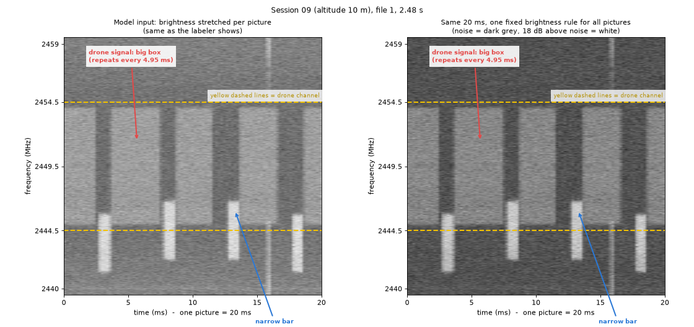

# RF Drone Detector

[](https://doi.org/10.5281/zenodo.23656790)

English | [한국어](README.ko.md)

**Drone signals can be synthesized from public datasets, but the interference should not be generated: for crowded places, train on real background IQ data recorded with the drone off.**

A HackRF One (a low-cost software-defined radio with 20 MHz instantaneous bandwidth) listens to the 2.4 GHz band. Every 20 ms of IQ samples becomes one 640 × 640 spectrogram, and a YOLO26s detector draws a box around the drone video link. Training images are synthesized at the IQ level, so no image is labeled by hand.

This version (v2.1) holds the code and results of the paper *Synthetic Drone Signals on Real Background IQ Data for Low-Cost SDR Drone Detection in Crowded Environments* (manuscript in preparation). The hackathon version (v1) is kept in the folder [`v1/`](v1/README.md), in the branch `v1`, and in the tags `v1.0` and `v1.1`.



*One image = 20 ms of HackRF IQ data (DJI Neo 2 flying at 10 m in a park). Horizontal: time, 0–20 ms. Vertical: frequency, 20 MHz (top = higher). Brighter = stronger. Left: the image the model sees. Right: the same 20 ms with a fixed brightness scale. The dashed yellow lines (drawn by us) mark the drone channel; the repeating bright rectangles between them are the drone video link.*

## Main result

On two crowded sites that were never used for training, models trained with generated interference flagged almost every drone-off image as a drone. Models trained on the real background of the other crowded site did not.

**Table 1. Evaluation on the crowded sites (%)**

| Model | Training background | Evaluated at | Recall, drone video link on | FPR, drone off |
|---|---|---|---:|---:|
| Station-background model | Suwon Station concourse, drone off | subway car | 93.7 | 2.5 |
| Car-background model | subway car, drone off | Suwon Station concourse | 86.8–88.9 | 22.5 |
| Models trained with generated interference (40) | park noise + generated Wi-Fi and Bluetooth, four densities | both sites | 99.8–100 | 98.1–100 |

- Recall: share of images with the drone video link on in which the model found a drone box on the Neo 2 channel.
- FPR (false positive rate): share of images recorded with the drone off in which the model drew any drone box.
- The drone in these tests (DJI Neo 2) was not used to train any model. Each model uses the threshold chosen on its own validation set.
- Real-background models: mean of 2 seeds. Generated-interference models: range over the four training conditions, each the mean of 5 folds × 2 seeds.

The generated-interference models were not weak in general. On synthetic test images with 80 % spectrum occupancy, the models trained with the 80 % condition kept FPR at 8.5 %. Besides the background, the real-background models also differ from them in the number of classes (one against three) and in the drone models used for training (all 20 against about 16 per fold).

## How the training images are made

1. **Drone signals.** 303 drone signal segments of 20 drone models are cut from four public datasets (DRFF-R2, Tampere University drone RF recordings, DroneDetect V2, RFUAV).
2. **Background.** One of two kinds.
   - Generated interference: 20 ms of HackRF noise from a park (drone off) plus generated Wi-Fi and Bluetooth bursts. The number of bursts is set so that the median spectrum occupancy is 2, 20, 50 or 80 %. The models detect three classes (drone, Wi-Fi, Bluetooth).
   - Real background: 20 ms of HackRF IQ data recorded with the drone off at one crowded site, with nothing added. The models detect one class (drone). The station-background model saw about 10 s of background, the car-background model about 117 s.
3. **Synthesis.** The drone segments are added to the background at the IQ level with an SNR of 6–25 dB and turned into a spectrogram. The box comes from the known insertion position.
4. **Training.** YOLO26s from the COCO weights, 40 epochs, batch 16, last-epoch weights, 6,000 training and 600 validation images per model. The threshold is the one with the highest image-level F1 on the validation images.

Generated-interference models: 4 conditions × 5 folds × 2 seeds = 40 models. A fold leaves out one product family (Mini, Air, Mavic, professional, other makers), so the unseen-family test uses drone models that the model never saw. Real-background models: one per site and seed. A data leakage check runs before training (`paper/results/leak_check.md`, `paper/results/exp2/leak.txt`). All HackRF recordings used in the paper were made with the 20 MHz receive filter.

## Names in the paper and in the code

File names and names inside the code keep the names used while the experiments ran. The result tables (`paper/results/*.md`) use the names of the paper.

**Table 2. Names in the paper and in the code**

| In the paper | In the code and file names |
|---|---|
| Models trained with generated interference | `<fold>_<condition>_s<seed>`, for example `f1_mini_c80_s1` |
| 2 / 20 / 50 / 80 % conditions | `c02`, `c20`, `c50`, `c80` |
| Folds that leave out Mini, Air, Mavic, professional, other makers | `f1_mini`, `f2_air`, `f3_mavic`, `f4_pro`, `f5_other` |
| Car-background model | `test2_1_s1`, `test2_1_s2` |
| Station-background model | `test2_2_s1`, `test2_2_s2` |
| Unseen-family test (synthetic) | `test1_1` (`rev1_eval.py`) |
| Neo 2 synthetic test | `test1_2` (`rev1_test1_2.py`) |
| Low-interference real test (park, indoor) | `test1_3`, `baseline` (`rev1_eval.py`) |
| Crowded-site real test | `test1_4` (`rev1_test1_4.py`) |

`rev1` in the file names is the experiment design of the paper; it is not related to v1 of the repository. The result tables and the code comments are in Korean.

## Repository layout

```
paper/src/              experiments of the paper
  rev1_common.py          folds, density conditions, seeds, image counts, folders
  rev1_synth.py           generated-interference images: density calibration, training/validation/test sets
  rev1_test1_2.py         Neo 2 synthetic test: images and evaluation
  rev1_leak.py            data leakage check (training starts only if every check passes)
  rev1_eval.py            validation threshold, unseen-family test, low-interference real test
  rev1_report.py          result tables of the 40 models
  rev1_test1_4.py         crowded-site test
  rev1_exp2.py            real-background models: images, leakage check, evaluation, tables
  rev1_gt_vis.py          images with the ground-truth drone boxes drawn, for checking labels
  occupancy.py            spectrum occupancy
  noise_level.py          noise level of the backgrounds
  neo2_burst_sessions.py  Neo 2 burst length and period
  fig_rev1.py, fig_rev2.py, fig_exp2_curves.py   figures (Korean labels)
paper/results/          result tables and leakage checks
src/                    shared modules: IQ synthesis, spectrogram, drone signal segments, background noise, training
scripts/                reproduce_paper.sh, download_drff_r2.sh
data/labels/, data/lists/   human-reviewed DRFF-R2 drone bands, DRFF-R2 file list
v1/                     hackathon version (v1.1)
```

## Reproduce

1. **Environment.** The same as v1: Python 3.11.16 (conda), torch 2.14.0 with CUDA 13.0, ultralytics 8.4.157, on an NVIDIA DGX Spark (GB10). `requirements-lock.txt` is the full package list of the environment that ran the paper.

   ```bash
   conda create -n rfdd python=3.11.16 -y && conda activate rfdd
   pip install torch==2.14.0 torchvision==0.29.0 --index-url https://download.pytorch.org/whl/cu130   # other GPUs: the torch 2.14.0 wheel for your CUDA
   pip install -r requirements.txt
   ```

   Put the COCO-pretrained `yolo26s.pt` from the [v1.0 release](https://github.com/sinkei9456/rf-drone-detector/releases/tag/v1.0) into `src/`.
2. **Data** into `data/raw/`, laid out as in the v1 README ([Data](v1/README.md#data)): four public datasets (about 150 GB) and our hackathon HackRF data (release v1.0, 5.6 GB). The crowded-site data go to `data/raw/hackrf/4_neo2_crowded_20261114/` but are not public (see below).
3. **Run** from the repository root:

   ```bash
   bash scripts/reproduce_paper.sh                 # materials, generated, crowded
   bash scripts/reproduce_paper.sh materials generated   # everything that runs on public data
   ```

   **Table 3. Parts of the script and time on one DGX Spark**

   | Part | What it does | Time |
   |---|---|---|
   | `materials` | park background and drone signal segments (steps 02–07 of v1) | — |
   | `generated` | images, leakage check, 40 trainings and evaluations, result tables | about 38 h (estimated) |
   | `crowded` | crowded-site test of the 40 models, 4 real-background models | about 5 h (estimated) |
   | `figures` | figures of the paper (needs the NanumGothic font) | — |

   Each step writes `runs/logs/paper_<step>.log`; finished steps are skipped when the script runs again. Results go to `paper/runs/rev1/`; the copies in `paper/results/` are the ones in the paper.

From a fresh clone of v2.1, the evaluation of all 44 models gave the same per-image outputs as `paper/results/` ([Reproduction check](#reproduction-check)). Image synthesis and training were not re-run from the fresh clone.

## Released weights

The [v2.1 release](https://github.com/sinkei9456/rf-drone-detector/releases/tag/v2.1) has the four real-background models of Table 1. The 40 generated-interference models are not attached; `scripts/reproduce_paper.sh generated` trains them again.

**Table 4. Weight files (threshold: chosen on the model's own validation images)**

| File | Model | Training background | Threshold |
|---|---|---|---:|
| `test2_1_s1.pt` | car-background model, seed 1 | subway car, drone off | 0.02 |
| `test2_1_s2.pt` | car-background model, seed 2 | subway car, drone off | 0.01 |
| `test2_2_s1.pt` | station-background model, seed 1 | Suwon Station concourse, drone off | 0.06 |
| `test2_2_s2.pt` | station-background model, seed 2 | Suwon Station concourse, drone off | 0.04 |

Checksums: `SHA256SUMS_weights.txt` in the release. Each file is an Ultralytics YOLO26s model with one class (`drone`). The input is an image made by `src/iq_to_image.py` from HackRF IQ data (2.4 GHz, 20 MS/s). An image counts as "drone" when a drone box has a confidence at or above the threshold.

```python
from ultralytics import YOLO
model = YOLO("test2_2_s1.pt")
boxes = model.predict("image.png", conf=0.06, verbose=False)[0].boxes
```

The training paths stored inside the files were made relative and renamed to the names above; the weights themselves are unchanged. The v2.0 release also holds the weights of a comparison model that is no longer part of the paper (`test2_c_s1.pt`, `test2_c_s2.pt`).

## Reproduction check

All 44 models of the paper (40 generated-interference models, 4 real-background models) were evaluated again from a fresh clone of v2.1, on the same machine and in the same environment as the paper. The clone was linked to the existing synthesized images, HackRF data and model weights. Everything after that ran in the clone: the leakage checks, the checks of the evaluation data, the list of crowded-site IQ files, all evaluations, the result tables, and Figures 2 and 6.

**Table 5. Evaluations re-run from the fresh clone (images per model)**

| Evaluation | Images | Models |
|---|---:|---:|
| Validation | 600 | 44 |
| Unseen-family test | 4,000 | 40 |
| Neo 2 synthetic test | 2,000 | 40 |
| Low-interference real test | 6,366 | 44 |
| Crowded-site real test | 15,163 | 44 |

For every model and evaluation, the per-image outputs (the highest drone confidence of each image, and the highest confidence of a box on the drone) and the threshold chosen on the validation images were identical to those of the paper: 256 items, 0 differences. The low-interference real test now has 6,366 images, because the 250 images of the indoor drone-off recording made with the 15 MHz receive filter were removed; the other images were compared one by one. The leakage checks passed, and the crowded-site IQ file list, the spectrum occupancy of each crowded-site image and the Neo 2 burst positions were identical. The run took 2 h 37 min on one DGX Spark.

### Rerun from the raw data (2026-11-25)

A fresh clone of main was run again from the raw IQ data with `scripts/reproduce_paper.sh`, on the same DGX Spark and in the same environment. Only `data/raw/` and the COCO weights `src/yolo26s.pt` were linked. Every segment, image, label and model was made in the clone.

- Datasets were identical to those of the paper: the training and validation image lists of the 40 generated-interference models and the 4 real-background models (6,000 training and 600 validation images per model), the synthesis summary, the leakage checks, the Neo 2 synthetic test, the crowded-site images (Suwon Station 2,516, train car 12,647), the crowded-site IQ file list and the noise levels. Sampled images were byte-identical.
- 9 of the 40 generated-interference models were trained again from the COCO weights (`f1_mini_*_s1`, `f2_air_*_s1`, `f3_mavic_c02_s1`). Their validation thresholds and per-image outputs were identical to those of the paper, although the weight files were not byte-identical. The other models were not trained again.
- The run first stopped at step 05: the folder pattern of the park sessions also picked a documentation folder that has no IQ files. The pattern now selects sessions 01–13 only.

### Why your numbers may differ

The datasets are made on the CPU with fixed seeds and do not depend on the GPU. Training and inference run on the GPU. With another GPU, driver, CUDA, PyTorch or Ultralytics version, the order of floating-point operations can change, so the weights, confidences and thresholds can differ slightly even with the same seed. On the machine of the paper (one DGX Spark, `requirements-lock.txt`) the rerun gave identical outputs. Inference times depend on the hardware and on other jobs running at the same time.

## Changes after v2.1

- `scripts/reproduce_paper.sh`: step 05 selects park sessions 01–13 only.
- `paper/results/RESULTS.md` and `paper/src/rev1_report.py`: the spectrum occupancy of the low-interference data is mostly 0.1–0.9 % and 2.4–4.1 % in park sessions 01 and 13 and the indoor drone-on data. Table 3-2 names the sessions by the drone distance (about 50 m) instead of the altitude.
- `paper/src/noise_level.py` and `paper/results/exp2/noise_level.json`: noise levels of the park, train-car and station backgrounds (Section 4.3). The comment in `rev1_exp2.py` gives these values.

## Changes from v2.0

- The mixed condition (the images of the four densities in equal parts) is removed; there are 40 generated-interference models. Figure 6 and the real-background tables compare with the 80 % condition.
- The comparison model trained like the real-background models but on park noise with generated interference (`test2_c`) is removed.
- Only HackRF data recorded with the 20 MHz receive filter are used: the indoor drone-off recording of 10-07 (15 MHz) is no longer evaluated, and the receiver noise recorded with the antenna removed (15 MHz) is no longer prepared or plotted.
- The result tables use the names of the paper (numbers, file names and JSON keys are unchanged).

## Data

- Public datasets: DRFF-R2, Tampere University drone RF recordings, DroneDetect V2 and RFUAV, each under its own license (download and layout: [v1 README](v1/README.md#data)).
- Our hackathon HackRF data (park and indoor, DJI Neo 2 on and off): the `hackrf_*.tar` files of the [v1.0 release](https://github.com/sinkei9456/rf-drone-detector/releases/tag/v1.0), CC BY 4.0. The paper uses only the park and indoor (10-08) recordings made with the 20 MHz receive filter.
- Crowded-site HackRF data (Suwon Station concourse and a Seoul Metropolitan Subway Line 1 car, 2026-11-14): not public, because the raw IQ data contain other people's transmissions. The results are in `paper/results/test1_4/` and `paper/results/exp2/`.

## Citation

This repository (all versions): Kim, Jeonghwan. RF Drone Detector. Zenodo. https://doi.org/10.5281/zenodo.23656790 (this release v2.1, the code of the paper: https://doi.org/10.5281/zenodo.24471317; v2.0: https://doi.org/10.5281/zenodo.24345339). A `CITATION.cff` file is included. The paper is in preparation.

## License

Code and model weights: AGPL-3.0 (`LICENSE`), because the code uses Ultralytics YOLO (AGPL-3.0) and the models are fine-tuned from Ultralytics weights.
Our hackathon HackRF data (release v1.0, `hackrf_*.tar`): CC BY 4.0 (https://creativecommons.org/licenses/by/4.0/); please cite this repository.
The public datasets keep their own licenses and are not redistributed here.
